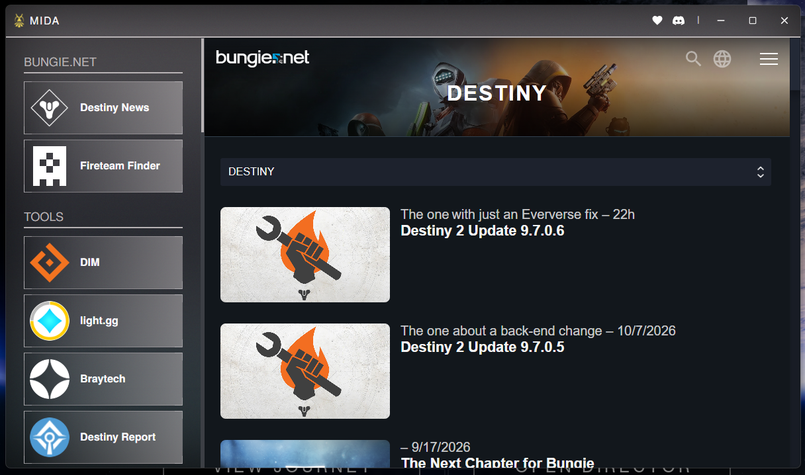
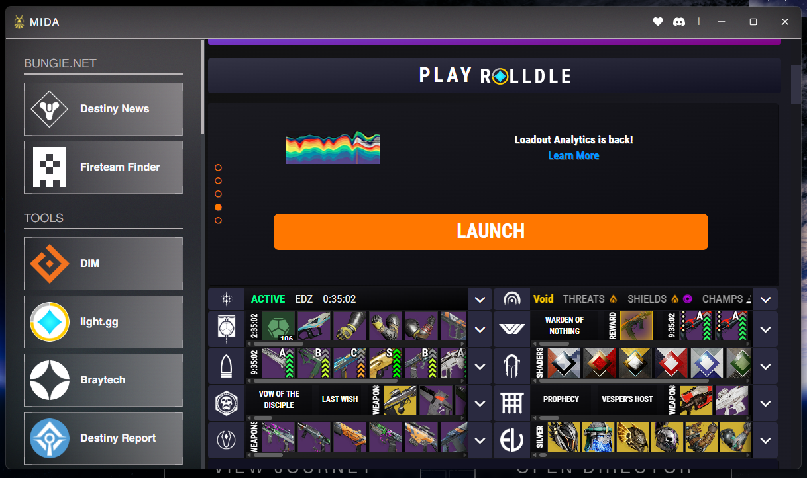
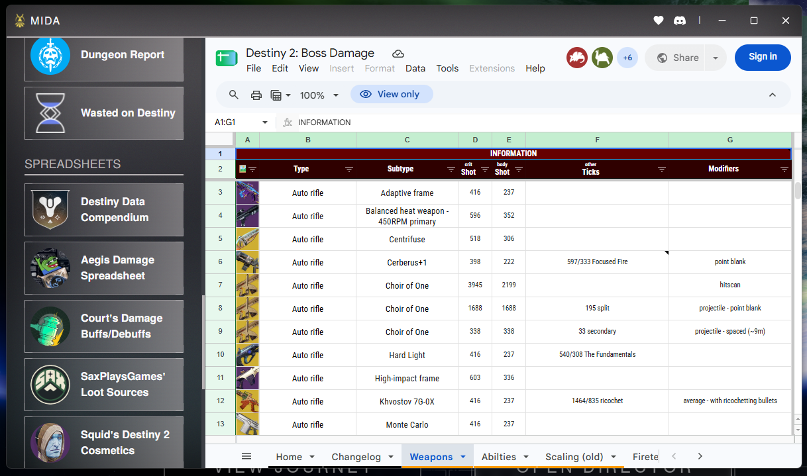

# MIDA


# ‼️ONLY DOWNLOAD MIDA FROM THIS REPO. WE HAVE DESCOVERED WEBSITES HOSTING MALICOUS CODE PRETENDING TO BE MIDA‼️

The Destiny 2 Multi-Tool. MIDA puts Bungie.net, DIM, light.gg, raid.report and other Destiny 2 sites in one window, with one shared Bungie.net sign-in.

## Features

- All the best Destiny 2 sites in one sidebar.
- Sign in to Bungie.net once. MIDA keeps only the Bungie.net login and deletes Steam, Xbox and PlayStation sign-in cookies.
- **F2** shows or hides MIDA over the game.
- MIDA has auto apdates
- Customisable your tabs

## Donations

MIDA is completely free for anyone. If you have some spare change or really love MIDA please consider donating to out Ko-fi. Thank you <3

## Screenshots






## Download

Get the installer from [Releases](https://github.com/itznao/mida/releases/latest).

## Build from source

You need [Node.js](https://nodejs.org/).

```bash
npm install
npm run dist:win
```

## Where MIDA saves data

Everything is in `%LOCALAPPDATA%\MIDA`. Uninstalling does not delete this folder.
Edit the `sites.json` file and change the version to `99.99.99` to ensure updates don't override your custom tabs.
